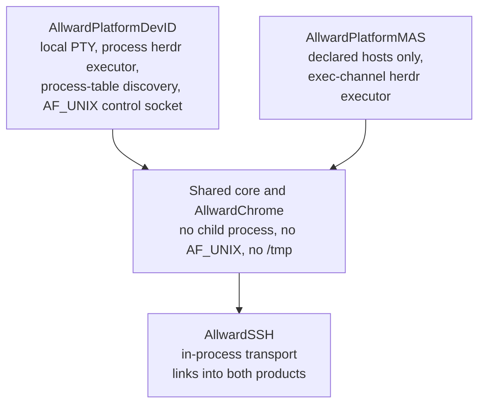

# Plan: build the sandboxed MAS product

Status: **every phase has landed.** Two residuals remain, each named next to the
phase that owns it: reverse port forwarding is half ported, and iCloud Keychain
syncing is refused for want of a provisioned entitlement, which decision 39 should
be re-weighed against. Written 2026-08-02.

This document is self-contained. Everything it cites lives in this repository.

## 1. Why this exists

Two products were accepted before the first commit.
[Decision 5](DECISIONS.md) reads:

> Dev ID (local PTY) + MAS (sandboxed, remote-only) built from day one; MAS
> *submission* deferred.

[ARCHITECTURE.md](ARCHITECTURE.md) rule 2 states the mechanism:

> **Link-time target isolation.** `AllwardLocalPTY` links only into the Developer
> ID product. The shared core remains sandbox-clean; the MAS product cannot call
> local PTY code because that code is absent from its graph.

[SPEC.md](SPEC.md) §2 states the constraint that governs every module:

> `AllwardLocalPTY` and `AllwardLocalPublisherEndpoint` are the only v1
> product-capability modules omitted from MAS; remote publishers still enter MAS
> through reverse SSH. Shared code MUST NOT assume `/tmp`, unrestricted file
> access, child-process launch, a socket family, or ssh-agent access. Platform
> services enter through injected file, credential, transport, speech, model, and
> clock interfaces.

The §15 product matrix gives MAS direct SSH, the optional multiplexer adapter,
MCP, speech, intelligence, and all v1 surfaces, and excludes `AllwardLocalPTY`,
`AllwardLocalPublisherEndpoint`, local child-process and listener code, and
their transitive dependencies.

Risk **R-02** in §17 names the failure this plan repairs: *two products from day
one; late sandbox or entitlement discovery invalidates shared code.* That
discovery has now happened. See §3.

## 2. Scope

In scope: a second application product that builds, links, and validates under
App Sandbox from the same source revision, and the shared-code changes required
to make that possible.

Out of scope, by [Decision 5](DECISIONS.md): **submission to the Mac App Store.**
The deferral covers submission only, never sandbox work or validation.

Also out of scope: any local-terminal capability in MAS. MAS is remote-only.
There is no reduced local shell, no helper that spawns one, and no offer of one
in the UI.

## 3. Measured drift

Phase 1 replaced this hand-reproduced table with a script. Run it and read the
failures:

```sh
python3 scripts/mas-isolation-receipts.py
```

| Requirement | Current state | Evidence |
| --- | --- | --- |
| Two products from one revision | both exist: `allward` and `allward-mas` | `Package.swift`, `darwinProducts` |
| MAS isolation manifest and four receipts | present, and all four fail | `scripts/mas-isolation.json`, `scripts/mas-isolation-receipts.py` |
| `AllwardSSH` ships in MAS | `AllwardSSH` depends on `AllwardLocalPTY`, and opens sessions by launching `/usr/bin/ssh` | receipt 1; `SSHCommandBuilder` in `Sources/AllwardSSH/SSHTransport.swift` |
| Shared code assumes no child-process launch | `HerdrProcessExecutor` and `HerdrDiscovery` launch processes and `ControlSocketHost` binds AF_UNIX, all inside shared `AllwardChrome` | receipt 2 |
| Sandboxed build exists | no | [TESTING.md](TESTING.md) known gaps |

Receipt 1 corrected this plan. It reports a shortest path plus every target that
declares the forbidden module:

```text
AllwardLocalPTY                allward-mas -> AllwardChrome -> AllwardControl -> AllwardLocalPTY
                               declared by: AllwardControl, AllwardSSH
AllwardLocalPublisherEndpoint  allward-mas -> AllwardChrome -> AllwardLocalPublisherEndpoint
                               declared by: AllwardChrome
CAllwardPTY                    ... -> AllwardControl -> AllwardLocalPTY -> CAllwardPTY
                               declared by: AllwardLocalPTY
```

So removing the `AllwardSSH` edge in phase 2 does not by itself clear the graph.
`AllwardControl` names `AllwardLocalPTY` in its own dependency list, and
`AllwardChrome` names `AllwardLocalPublisherEndpoint` in its. Phase 3 owns both,
and until then a shortest path alone would not even show the `AllwardSSH` edge.
Direct SSH remains the blocking capability: MAS **must** ship it, and it is built
on a module MAS forbids.

One seam is already correct and must be preserved: `HerdrSocketClient` takes an
injected `HerdrCommandExecutor`, so `AllwardHerdr` itself is sandbox-clean. Only
the concrete process-launching executor is in the wrong module.

## 4. Target architecture



Four properties define the target.

1. **`AllwardSSH` no longer depends on `AllwardLocalPTY`.** That one edge is what
   makes a MAS product impossible today.
2. **One SSH transport, in both products.** §16 fails a build on *B/C divergence*
   across the §5 SSH lifecycle cells, and the §14 per-target key boundary permits
   Dev ID and MAS to differ in their credential and host-trust **stores**, not in
   their transport. Two transport implementations would guarantee the divergence
   the gate rejects.
3. **Platform capabilities are injected, never imported.** Anything that spawns a
   process, binds a UNIX socket, reaches ssh-agent, or assumes `/tmp` moves into a
   product-specific platform module behind a protocol declared in shared code.
4. **The herdr adapter works in MAS.** Its executor becomes an SSH exec channel on
   the same connection. `HerdrEndpoint` keeps describing the command; only
   execution changes. `HerdrExecutionSite.local` has no meaning in MAS.

### Consequences worth stating plainly

- Automatic discovery of a herdr running on this machine is Dev-ID-only, because
  it reads the process table. In MAS a Room's server is **declared**, which is
  what the Settings and Board connect controls already do.
- A sandboxed product cannot read `~/.ssh/config`, so SSH host aliases defined
  there do not resolve, and neither does prior host-key pinning in
  `~/.ssh/known_hosts`. MAS hosts come from Allward's own configuration.
  Measured; see [evidence/SANDBOX.md](evidence/SANDBOX.md).
- A sandboxed product cannot reach the ssh-agent socket, though it does inherit
  `SSH_AUTH_SOCK`. Measured, so this is settled rather than assumed. MAS
  authenticates with keys the user has imported, which is D-B's remaining half.
- One in-process connection carrying many channels replaces the current full SSH
  handshake per herdr command.

## 5. Decisions, both now settled

Both were blocked on facts nobody had gathered.
[evidence/SANDBOX.md](evidence/SANDBOX.md) gathered them, and the owner has ruled.
Decisions 39 and 40 in [DECISIONS.md](DECISIONS.md) are the record. **No phase is
blocked on a decision any more.**

**D-A - SSH library. Decided: `russh`.** MAS needs in-process SSH, though not for
the reason first written here. App Sandbox **permits** launching `/usr/bin/ssh`;
the child inherits the sandbox and then cannot read `~/.ssh/config`,
`known_hosts`, or any key, so a spawned client is starved. This is Allward's first
external package dependency and its first non-C foreign language. Writing an SSH
implementation instead would have combined the R-01 risk (*from-scratch engine
consumes the project*) with a cryptographic attack surface.

The seam is verified rather than assumed: `russh` 0.62.5 builds as a
`staticlib` for `aarch64-apple-darwin`, Swift links and calls it over a C ABI, it
recognises all three RSA algorithms, and the resulting binary links only libraries
`scripts/mas-isolation.json` already permits. Adopting it widens the MAS manifest
by nothing. The build must pin a **stable** Rust toolchain; the machine's default
is a nightly. The C header is generated by `cbindgen`, committed, and guarded by a
receipt that regenerates and diffs it, so the Swift declarations cannot drift from
the Rust that backs them.

Why not the others. `swift-nio-ssh` was **disqualified**, and not on taste: it
cannot represent an RSA key at all, for host keys or user keys, and it exposes no
way to inject an external signer, because `NIOSSHPrivateKey` has a closed internal
backing enum and a private initialiser. A measured key inventory is 16 RSA private
keys to 2 Ed25519, several of them cloud-provider keys whose public half cannot be
swapped at will, so it could not authenticate with most of the keys that exist. It
is also pre-1.0 with one commit in twelve months, and its README says it "does not
ship production-ready SSH clients and servers, but instead provides the building
blocks". `libssh2` was the runner-up and is licence-clean and mature, but it has
no Apple-native crypto backend, so it would have meant vendoring a C SSH library
*and* a C crypto library. `libssh` is LGPL-2.1. Full ranking in
[evidence/SANDBOX.md](evidence/SANDBOX.md).

**D-B - the MAS credential route. Decided: Keychain, synchronising over iCloud.**
ssh-agent is measurably unreachable under App Sandbox, so "no agent" was never a
choice. `~/.ssh/config` and `~/.ssh/known_hosts` are unreadable, so hosts come
from Allward's own configuration and prior pinning is invisible.

Keys are Keychain items marked `kSecAttrSynchronizable`. Apple documents that the
keychain synchronises cryptographic keys, not only passwords, from macOS 11
onward, so this is a supported route. It costs the `ThisDeviceOnly` protection
classes, `SecAccess`-based access control, and persistent references.

The Secure Enclave is **not** a later upgrade for these keys. It cannot encode a
preexisting key, it accepts no plaintext key import by design, and it does NIST
P-256 only, so none of the keys anyone already holds can go into it. It is a
distinct choice for a newly generated key on one machine, and taking it forfeits
iCloud sync entirely, because a key that cannot leave one enclave cannot appear on
another device. Offer it as an alternative, never as an improvement.

One measurement is still outstanding: Keychain returned
`errSecInteractionNotAllowed` under an ad-hoc signature, so the store is unproven
until `fixtures/mas-sandbox-probe/run.sh` runs with a real signing identity and an
unlocked keychain. Both products MUST keep identical trust and cancellation
semantics.

## 6. Phases

Each phase lands independently and leaves the tree green.

### Phase 1 - stand up the MAS product, failing (landed)

`allward-mas` is the second application product, `scripts/mas-isolation.json` is
the closed manifest that defines it, and `scripts/mas-isolation-receipts.py`
emits the four receipts §2 requires: resolved dependency-graph exclusion,
negative compile fixtures, archive linker-map and linked-library closure, and
final artifact inspection.

`scripts/no-adapter-clean-build-test.sh` was the precedent for a manifest-driven
exclusion receipt; the MAS receipts consume their own manifest the same way.

This plan predicted the product would not build. It does. A SwiftPM dependency is
declared per target, not per product, so a MAS product cannot subtract
`AllwardLocalPTY` from `AllwardChrome`'s own dependency list; expressing that is
what phase 3 is for. The compiler was never going to be the signal. The receipts
are, and all four fail. `Sources/allward-mas/main.swift` refuses to launch for
the same reason, so no binary labelled MAS can offer a local shell in the
meantime.

- **Accepted when:** a script emits all four receipts, and they fail loudly and
  specifically, naming `AllwardLocalPTY` reached through `AllwardSSH`. Receipt 1
  reports `declared by: AllwardControl, AllwardSSH`; receipts 3 and 4 name the
  absent archive. Verified on macOS 26.5.2.
- **Guards against:** shared code drifting further toward the Dev ID product
  while nothing checks.

### Phase 2 - in-process SSH transport (landed)

`rust/allward-ssh` runs the protocol behind the existing `RemoteTransport` facade,
reached over one generated C ABI. `AllwardSSH` no longer depends on
`AllwardLocalPTY`, which is the edge that made a MAS product impossible. PTY and
exec channels both work: panes need the former, the herdr executor the latter.

- **Accepted when:** receipts 1 and 2 stop reporting `AllwardLocalPTY`. Both now
  pass in full. Five live tests open sessions to a real `sshd` with a 4096-bit RSA
  key, covering exec, a login shell with input and resize, a refused host key, and
  an unconfigured alias.
- **Now done:** the §5 lifecycle harness exists.
  `scripts/ssh-lifecycle-receipt.sh` reports nine cells passing against a real
  server (connect, authenticate, live remote PTY, control, exit code, trust,
  cancel, close, disconnect) and names the three it cannot reach. Building it found
  a real defect: an in-flight open ignored cancellation, so a cancelled pane left a
  handshake running. `RusshChannel` now closes and reports `.cancelled`.
- **Not done:** endpoint forwarding is half ported. Direct-tcpip (local) forwarding
  works over russh and has a live test. Reverse forwarding does not: the server
  accepts `tcpip_forward` and establishes the listener, but
  `server_channel_open_forwarded_tcpip` is never reached when a connection arrives,
  so no stream is delivered. The override matches the trait signature exactly, so it
  is a real override rather than a silently-inherent method, and the cause is
  unidentified. `Tests/AllwardSSHTests/RusshForwardingTests.swift` keeps the
  reproduction, skipped so it cannot hang a suite; remove the skip to work on it.
  Until it passes, `SSHPortForwarding` stays in `AllwardPlatformDevID` spawning
  `ssh -R`, so reverse forwarding is a §5 facade capability MAS still lacks, and
  `CELL forward` stays skipped.

### Phase 3 - move platform code out of shared modules (landed)

`PlatformServices` is declared in `AllwardControl`, and `AllwardPlatformDevID` and
`AllwardPlatformMAS` supply it. Local PTY spawning, process-table herdr discovery,
the process herdr executor, and the AF_UNIX control socket host are all in the
Developer ID module.

- **Accepted when:** the negative fixtures pass and `AllwardChrome` holds no
  process launch or socket bind. Both hold, and Chrome joined the no-adapter
  proof's core target list, which it could not before.

### Phase 4 - herdr over an exec channel (landed)

`HerdrExecChannelExecutor` runs the same argv as an exec channel on the Room's own
connection. `HerdrEndpoint.remoteCommand(from:)` removes the transport prefix that
`argv(for:)` added, and refuses an argv of any other shape. The Developer ID
product keeps its process executor untouched.

- **Accepted when:** a declared Room reaches its server with no process launched.
  A live test runs a real command over a real exec channel.
- **Now done:** the herdr protocol itself is proven against a real herdr server,
  not a stub. A live test decodes a session snapshot and an agent list through the
  exec channel; the server reports version 0.7.5 and protocol 17, which is exactly
  what the client demands, so there is no version drift. A stub was written first
  and rejected: it would only have proven that the fake agreed with the client.

### Phase 5 - credentials and host trust (landed in part)

Keys live in the Keychain as `kSecAttrSynchronizable` items and sign through
`SecKeyCreateSignature`, so the transport never holds key bytes. Host trust is
durable, atomic, refuses a changed key, and reports the expected fingerprint.

- **Accepted when:** a real server accepts a signature the credential store
  produced. It does, with no `identityFile` configured, so authentication went
  entirely through the signer.
- **Now done:** the credential lifecycle is measured against a real Keychain, not a
  double. Import, use, rotation, deletion, per-host scoping, and service-namespace
  isolation all pass: a stored key is read back and signs, a rotation changes which
  key is offered and reaches storage, and a deletion makes signing fail rather than
  fall back. Artifact hygiene is measured too, by
  `scripts/credential-hygiene-receipt.sh`: no key material in diagnostics, in files
  Allward writes, or embedded in a built binary. That work also found and fixed a
  real leak: a private key pasted into `identity-file` was written back to
  `allward.toml`, since Allward rewrites that file itself. Configuration now refuses
  it at load.
- **Now measured:** Keychain access works in a signed sandboxed build. A signed
  probe added an item and read it back with the value matching, so the earlier
  `errSecInteractionNotAllowed` was the missing team identifier and not a sandbox
  prohibition. Decision 39's premise holds.
- **Measured and refused:** `kSecAttrSynchronizable` answers `-34018`,
  `errSecMissingEntitlement`, in a signed sandboxed build. A signing identity does
  not fix it: the iCloud Keychain entitlement is provisioned through an App
  Store or iCloud-capable profile, which is submission-adjacent work decision 5
  defers. Keys are stored and used correctly; what is unproven is only whether they
  appear on a second Mac, and no surface may claim they do until this row passes.
  This is the one measured fact that argues against decision 39 as written, and it
  is the owner's to weigh. See [evidence/SANDBOX.md](evidence/SANDBOX.md).

### Phase 6 - archive and validate (landed)

`scripts/make-mas-app.sh` produces the sandboxed archive with its entitlements and
the linker map receipt 3 reads. All four receipts pass against the real archive.
Submission remains deferred by decision 5.

- **Accepted when:** the sandboxed product launches direct SSH and proves no
  reachable local-PTY path. It does. A differential symbol scan finds `_forkpty`,
  `_bind`, `_listen`, `_accept`, `_execve`, and 296 `AllwardLocalPTY` symbols in
  the Developer ID binary and none in the MAS one. The sandboxed build was also
  photographed with a live remote session; the capture is not committed because it
  shows a real host name, so reproduce it rather than trust it:

  ```sh
  bash scripts/make-mas-app.sh
  # add an SSH host to the container's allward.toml, with a key inside the
  # container: the sandbox cannot read ~/.ssh, which is why decision 39 exists
  .build/Allward-MAS.app/Contents/MacOS/Allward \
      --capture "$HOME/Library/Containers/ai.allward.Allward.mas/Data/shot.png"
  ```
- **Not done:** `G1-core-C` is wider than this. MCP has no sandbox transport yet,
  and the speech and full UI paths were not exercised in the sandboxed build. The
  archive is also ad-hoc signed, so it is validated rather than distributable.

## 7. Verification

Every phase runs on a macOS 26 machine, with a Rust toolchain:

```sh
bash scripts/build-rust.sh                    # SwiftPM cannot build Rust
swift build
swift test
bash scripts/no-adapter-clean-build-test.sh
bash scripts/rust-header-drift.sh             # the C ABI header is generated
python3 scripts/validate-publication.py
```

The isolation receipts need the real archive, and now pass against it:

```sh
bash scripts/make-mas-app.sh
python3 scripts/mas-isolation-receipts.py \
    --archive .build/Allward-MAS.app --linker-map .build/mas-maps
```

Run without `--archive` they still report receipts 1 and 2 truthfully and fail 3
and 4 for want of an archive, which is the right answer to a question about a
build directory. The live SSH tests skip unless a server is named:

```sh
ALLWARD_SSH_TEST_HOST=… ALLWARD_SSH_TEST_USER=… ALLWARD_SSH_TEST_KEY=… \
    swift test --filter RusshTransportTests
```

A phase is complete when its receipts say so, not when the code compiles.

## 8. Non-goals

- Submitting to the Mac App Store.
- Any local shell, or a helper process that provides one, in MAS.
- Changing the Dev ID product's behaviour. Users of it should notice nothing
  except faster herdr polling after phase 2.
- Supporting untrusted third-party herdr servers. §14 requires a separate
  isolation threat model for that.
