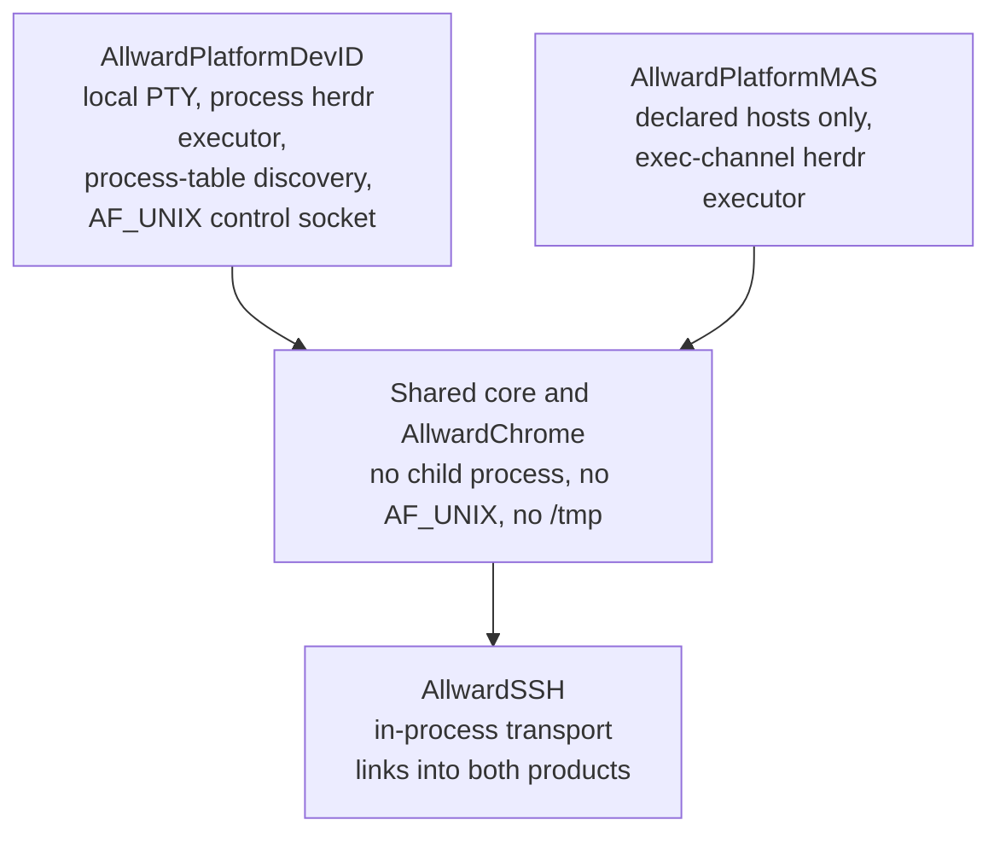

# Plan: build the sandboxed MAS product

Status: **phase 1 landed. Phase 2 is blocked on decision D-A.** Written
2026-08-02.

This document is self-contained. Everything it cites lives in this repository.

## 1. Why this exists

Two products were accepted before the first commit.
[Decision 5](DECISIONS.md) reads:

> Dev ID (local PTY) + MAS (sandboxed, remote-only) built from day one; MAS
> *submission* deferred.

[ARCHITECTURE.md](ARCHITECTURE.md) rule 2 states the mechanism:

> **Link-time target isolation.** `AllwardLocalPTY` links only into the Developer
> ID product. The shared core remains sandbox-clean; the MAS product cannot call
> local PTY code because that code is absent from its graph.

[SPEC.md](SPEC.md) §2 states the constraint that governs every module:

> `AllwardLocalPTY` and `AllwardLocalPublisherEndpoint` are the only v1
> product-capability modules omitted from MAS; remote publishers still enter MAS
> through reverse SSH. Shared code MUST NOT assume `/tmp`, unrestricted file
> access, child-process launch, a socket family, or ssh-agent access. Platform
> services enter through injected file, credential, transport, speech, model, and
> clock interfaces.

The §15 product matrix gives MAS direct SSH, the optional multiplexer adapter,
MCP, speech, intelligence, and all v1 surfaces, and excludes `AllwardLocalPTY`,
`AllwardLocalPublisherEndpoint`, local child-process and listener code, and
their transitive dependencies.

Risk **R-02** in §17 names the failure this plan repairs: *two products from day
one; late sandbox or entitlement discovery invalidates shared code.* That
discovery has now happened. See §3.

## 2. Scope

In scope: a second application product that builds, links, and validates under
App Sandbox from the same source revision, and the shared-code changes required
to make that possible.

Out of scope, by [Decision 5](DECISIONS.md): **submission to the Mac App Store.**
The deferral covers submission only, never sandbox work or validation.

Also out of scope: any local-terminal capability in MAS. MAS is remote-only.
There is no reduced local shell, no helper that spawns one, and no offer of one
in the UI.

## 3. Measured drift

Phase 1 replaced this hand-reproduced table with a script. Run it and read the
failures:

```sh
python3 scripts/mas-isolation-receipts.py
```

| Requirement | Current state | Evidence |
| --- | --- | --- |
| Two products from one revision | both exist: `allward` and `allward-mas` | `Package.swift`, `darwinProducts` |
| MAS isolation manifest and four receipts | present, and all four fail | `scripts/mas-isolation.json`, `scripts/mas-isolation-receipts.py` |
| `AllwardSSH` ships in MAS | `AllwardSSH` depends on `AllwardLocalPTY`, and opens sessions by launching `/usr/bin/ssh` | receipt 1; `SSHCommandBuilder` in `Sources/AllwardSSH/SSHTransport.swift` |
| Shared code assumes no child-process launch | `HerdrProcessExecutor` and `HerdrDiscovery` launch processes and `ControlSocketHost` binds AF_UNIX, all inside shared `AllwardChrome` | receipt 2 |
| Sandboxed build exists | no | [TESTING.md](TESTING.md) known gaps |

Receipt 1 corrected this plan. It reports a shortest path plus every target that
declares the forbidden module:

```text
AllwardLocalPTY                allward-mas -> AllwardChrome -> AllwardControl -> AllwardLocalPTY
                               declared by: AllwardControl, AllwardSSH
AllwardLocalPublisherEndpoint  allward-mas -> AllwardChrome -> AllwardLocalPublisherEndpoint
                               declared by: AllwardChrome
CAllwardPTY                    ... -> AllwardControl -> AllwardLocalPTY -> CAllwardPTY
                               declared by: AllwardLocalPTY
```

So removing the `AllwardSSH` edge in phase 2 does not by itself clear the graph.
`AllwardControl` names `AllwardLocalPTY` in its own dependency list, and
`AllwardChrome` names `AllwardLocalPublisherEndpoint` in its. Phase 3 owns both,
and until then a shortest path alone would not even show the `AllwardSSH` edge.
Direct SSH remains the blocking capability: MAS **must** ship it, and it is built
on a module MAS forbids.

One seam is already correct and must be preserved: `HerdrSocketClient` takes an
injected `HerdrCommandExecutor`, so `AllwardHerdr` itself is sandbox-clean. Only
the concrete process-launching executor is in the wrong module.

## 4. Target architecture



Four properties define the target.

1. **`AllwardSSH` no longer depends on `AllwardLocalPTY`.** That one edge is what
   makes a MAS product impossible today.
2. **One SSH transport, in both products.** §16 fails a build on *B/C divergence*
   across the §5 SSH lifecycle cells, and the §14 per-target key boundary permits
   Dev ID and MAS to differ in their credential and host-trust **stores**, not in
   their transport. Two transport implementations would guarantee the divergence
   the gate rejects.
3. **Platform capabilities are injected, never imported.** Anything that spawns a
   process, binds a UNIX socket, reaches ssh-agent, or assumes `/tmp` moves into a
   product-specific platform module behind a protocol declared in shared code.
4. **The herdr adapter works in MAS.** Its executor becomes an SSH exec channel on
   the same connection. `HerdrEndpoint` keeps describing the command; only
   execution changes. `HerdrExecutionSite.local` has no meaning in MAS.

### Consequences worth stating plainly

- Automatic discovery of a herdr running on this machine is Dev-ID-only, because
  it reads the process table. In MAS a Room's server is **declared**, which is
  what the Settings and Board connect controls already do.
- A sandboxed product cannot read `~/.ssh/config`, so SSH host aliases defined
  there do not resolve, and neither does prior host-key pinning in
  `~/.ssh/known_hosts`. MAS hosts come from Allward's own configuration.
  Measured; see [evidence/SANDBOX.md](evidence/SANDBOX.md).
- A sandboxed product cannot reach the ssh-agent socket, though it does inherit
  `SSH_AUTH_SOCK`. Measured, so this is settled rather than assumed. MAS
  authenticates with keys the user has imported, which is D-B's remaining half.
- One in-process connection carrying many channels replaces the current full SSH
  handshake per herdr command.

## 5. Decisions required before work starts

Two phases must not begin until the owner rules. Record each accepted decision in
[DECISIONS.md](DECISIONS.md). Both were blocked on facts nobody had gathered;
[evidence/SANDBOX.md](evidence/SANDBOX.md) now has them, so what remains is
genuinely a judgement rather than a gap.

**D-A - adopt an SSH library.** MAS needs in-process SSH, though not for the
reason first written here. App Sandbox **permits** launching `/usr/bin/ssh`; the
child inherits the sandbox and then cannot read `~/.ssh/config`, `known_hosts`,
or any key, so a spawned client is starved. This repository has no external
package dependencies today and no decision records a policy either way, so
adopting one is a new decision. Writing an implementation instead would combine
the R-01 risk (*from-scratch engine consumes the project*) with a cryptographic
attack surface, so the plan assumes a library.

`swift-nio-ssh` is the candidate and it is weaker than this plan assumed. It is
0.15.0 and pre-1.0; its README says it "does not ship production-ready SSH
clients and servers, but instead provides the building blocks"; it has had one
commit in twelve months; and it cannot represent an `ssh-rsa` **host** key at
all. Against a stock macOS `sshd` that costs nothing, because the server also
offers Ed25519 and the client negotiates. It costs a connection only where a
server offers no Ed25519 or ECDSA host key. It does support Secure Enclave P-256
private keys, which bears on D-B. The alternative worth ranking against it is
libssh2: licence-clean and algorithm-complete, but C, with no maintained Swift
binding, so we would own the bridge. libssh is LGPL-2.1 and needs legal review
before it is even a candidate. Blocks phase 2.

**D-B - the MAS credential route.** Mostly settled by measurement. ssh-agent is
**unreachable** under App Sandbox, so "no agent" is a fact, not a choice.
`~/.ssh/config` and `~/.ssh/known_hosts` are unreadable, so hosts come from
Allward's own configuration and prior pinning is invisible. What is still open is
one thing: Keychain returned `errSecInteractionNotAllowed` under an ad-hoc
signature, so key-import-to-Keychain is unproven until it is tried with a real
signing identity. Secure Enclave keys are the alternative worth weighing, since a
key that cannot be exported beats a key that can. Both products MUST keep
identical trust and cancellation semantics. Blocks phase 5.

## 6. Phases

Each phase lands independently and leaves the tree green.

### Phase 1 - stand up the MAS product, failing (landed)

`allward-mas` is the second application product, `scripts/mas-isolation.json` is
the closed manifest that defines it, and `scripts/mas-isolation-receipts.py`
emits the four receipts §2 requires: resolved dependency-graph exclusion,
negative compile fixtures, archive linker-map and linked-library closure, and
final artifact inspection.

`scripts/no-adapter-clean-build-test.sh` was the precedent for a manifest-driven
exclusion receipt; the MAS receipts consume their own manifest the same way.

This plan predicted the product would not build. It does. A SwiftPM dependency is
declared per target, not per product, so a MAS product cannot subtract
`AllwardLocalPTY` from `AllwardChrome`'s own dependency list; expressing that is
what phase 3 is for. The compiler was never going to be the signal. The receipts
are, and all four fail. `Sources/allward-mas/main.swift` refuses to launch for
the same reason, so no binary labelled MAS can offer a local shell in the
meantime.

- **Accepted when:** a script emits all four receipts, and they fail loudly and
  specifically, naming `AllwardLocalPTY` reached through `AllwardSSH`. Receipt 1
  reports `declared by: AllwardControl, AllwardSSH`; receipts 3 and 4 name the
  absent archive. Verified on macOS 26.5.2.
- **Guards against:** shared code drifting further toward the Dev ID product
  while nothing checks.

### Phase 2 - in-process SSH transport (blocked on D-A)

Replace the process-launching SSH implementation behind the existing
`RemoteTransport` facade, keeping `AllwardSSH` the only module that knows the
protocol. Remove its `AllwardLocalPTY` dependency.

Both PTY channels and exec channels are required: panes need the former, the
herdr executor needs the latter.

- **Accepts when:** every §5 SSH lifecycle cell passes against a real remote host
  with unchanged goldens, and the dependency-graph receipt from phase 1 stops
  reporting `AllwardLocalPTY`.
- **Guards against:** B/C divergence, which §16 fails a build for.

### Phase 3 - move platform code out of shared modules

Introduce `AllwardPlatformDevID` and `AllwardPlatformMAS` behind protocols
declared in shared code. Relocate local PTY spawning, the process-table herdr
discovery, the process herdr executor, and the AF_UNIX control socket host into
the Dev ID module. `AllwardChrome` keeps no direct reference to any of them.

- **Accepts when:** the negative compile fixtures pass, `AllwardChrome` contains
  no process launch or socket bind, and the Dev ID product behaves identically to
  today.
- **Guards against:** the §2 shared-code prohibition being satisfied by comment
  rather than by graph.

### Phase 4 - herdr over an exec channel

Add the MAS executor: same `HerdrEndpoint` argv, executed as an SSH exec channel
on the connection the Room already holds. Dev ID keeps its process executor.
Per-Room adapter selection and the Settings and Board connect controls are
unchanged.

- **Accepts when:** a Room declared against a remote herdr server lists its
  sessions in the MAS product with no process launched, and the Dev ID product is
  unaffected.
- **Guards against:** the adapter quietly becoming Dev-ID-only, which the §15
  product matrix forbids.

### Phase 5 - credentials and host trust (blocked on D-B)

Implement the injected credential and host-trust stores for both products and
close OQ-14 with its probe fixtures: import, unlock, use, rotation, deletion,
host-key first use and mismatch, sandbox access, logs, and crash artifacts, with
throwaway keys in both products.

- **Accepts when:** OQ-14's both-target receipts pass and no private-key material
  appears in UI, config, logs, protocol messages, or crash artifacts.

### Phase 6 - archive and validate

Produce the sandboxed archive with its entitlements, run the four receipts
against the real archive rather than a build directory, and record the result.
Submission remains deferred.

- **Accepts when:** `G1-core-C` passes: the sandboxed product launches direct SSH
  and all applicable UI, MCP, and speech paths, and proves no local-terminal offer
  and no reachable `AllwardLocalPTY` or `AllwardLocalPublisherEndpoint` path.

## 7. Verification

Every phase runs on a macOS 26 machine:

```sh
swift build
swift test
bash scripts/no-adapter-clean-build-test.sh
python3 scripts/mas-isolation-receipts.py
python3 scripts/validate-publication.py
```

The MAS receipts exit non-zero until phase 6, by design, so they are read rather
than merely run. Phases 3 and onward are measured by which of them stop failing.
Receipts 3 and 4 need a real archive:

```sh
python3 scripts/mas-isolation-receipts.py \
    --archive .build/Allward-MAS.app --linker-map .build/mas-maps
```

A phase is complete when its receipts say so, not when the code compiles.

## 8. Non-goals

- Submitting to the Mac App Store.
- Any local shell, or a helper process that provides one, in MAS.
- Changing the Dev ID product's behaviour. Users of it should notice nothing
  except faster herdr polling after phase 2.
- Supporting untrusted third-party herdr servers. §14 requires a separate
  isolation threat model for that.
